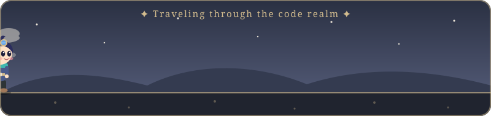

 

 

 

### ✦ Quick Travel Menu ✦

 

## ✦ Welcome, Traveler!

Welcome to my personal portfolio! I'm **Renze Daneille P. Rivero**, a **Bachelor of Science in Information Technology (BSIT)** student passionate about programming, web development, and creating things through code.

I enjoy building websites, experimenting with different technologies, developing small projects and games, and exploring new ideas. I also have experience handling **Minecraft servers** and creating **custom plugins and mods** to improve gameplay and add new features.

> *"Every great journey begins with a single line of code."* ✦

<b>✨ Click for a quick summary of who I am</b>

 

- 🎓 **BSIT Student**
- 💻 Interested in **Front-End** and **Back-End** Development
- 🌐 Passionate about **Web Development**
- 🎮 Enjoys creating **small projects and games**
- ⛏️ Experienced in handling **Minecraft servers**
- 🔧 Creates **Minecraft plugins and mods**
- 🚀 Always learning, experimenting, and improving my skills

## 📜 Adventurer's Profile

| ✦ | Attribute | Details |
|:-:|:--|:--|
| 🎓 | **Class** | BSIT Student |
| 💻 | **Specialty** | Front-End & Back-End Development |
| 🌐 | **Main Quest** | Web Development |
| 🎮 | **Side Quest** | Creating small projects and games |
| ⛏️ | **Expertise** | Handling Minecraft servers |
| 🔧 | **Crafting** | Minecraft plugins and mods |
| 🚀 | **Passive Talent** | Always learning, experimenting, and improving |

## 🌌 Elemental Resonance

*Every adventurer wields different elements. Here are mine:*

 

 

## ⚔️ Talents

> 💡 **Click each Domain below to open it!**

<b>🍃 Anemo Domain: Front-End Development</b>

 

- Building responsive and interactive websites
- Creating user-friendly interfaces
- Designing and developing personal and small-scale projects

<b>💎 Geo Domain: Back-End Development</b>

 

- Developing application logic and functionality
- Working with databases and server-side systems
- Exploring APIs and backend technologies

<b>🌱 Dendro Domain: Minecraft Development</b>

 

- Minecraft server management and configuration
- Custom plugin development
- Minecraft mod development
- Server customization and gameplay enhancements

<b>✨ Hidden Domain: Other Interests</b>

 

- Game development
- Small experimental projects
- Programming challenges
- Exploring new technologies

## 🗺️ Quest Log

I enjoy creating projects that allow me to learn, experiment, and turn ideas into working applications.

| Quest Type | Objective | Reward |
|:--|:--|:--|
| 🌐 **World Quest** | Web applications and websites | New skills ✦ |
| 🎮 **Event Quest** | Small games and interactive projects | Fun & experience ✦ |
| ⛏️ **Archon Quest** | Minecraft plugins and modifications | Better gameplay ✦ |
| 🛠️ **Hidden Quest** | Experimental tools and personal projects | Discoveries ✦ |

**Check out my portfolio to see some of the projects I've worked on!**

## 📊 Adventure Records

 

<b>📈 Click to open my contribution activity graph</b>

 

<b>🏆 Click to open my trophy case</b>

 

## 🎁 The Secret Chest

<b>🗝️ You found a hidden chest, click to open it!</b>

 

### ✦ Congratulations, Traveler! ✦

*You scrolled all the way down to find this.*

**Reward: one friendly collaborator invitation** 🎉

If you like building websites, small games, or Minecraft plugins and mods, let's connect and make something together.

## 🕊️ Send a Message in a Bottle

I'm always interested in connecting with fellow developers, learning from others, and sharing projects.

<b>📇 Adventurers' Guild Contact Card</b>

 

| Platform | Details |
|:--|:--|
| **GitHub** | VAELITH · [Hoshi-hikarin2208](https://github.com/Hoshi-hikarin2208) |
| **Facebook** | [Renze Riv](https://www.facebook.com/fRENZEyriv) |
| **Discord** | Vaelith · `totallynothikariyes` · ID `1445649011217399828` |
| **Email** | [renzerivero08@gmail.com](mailto:renzerivero08@gmail.com) |

✦ *"May you find your way through the code, Traveler."* ✦

